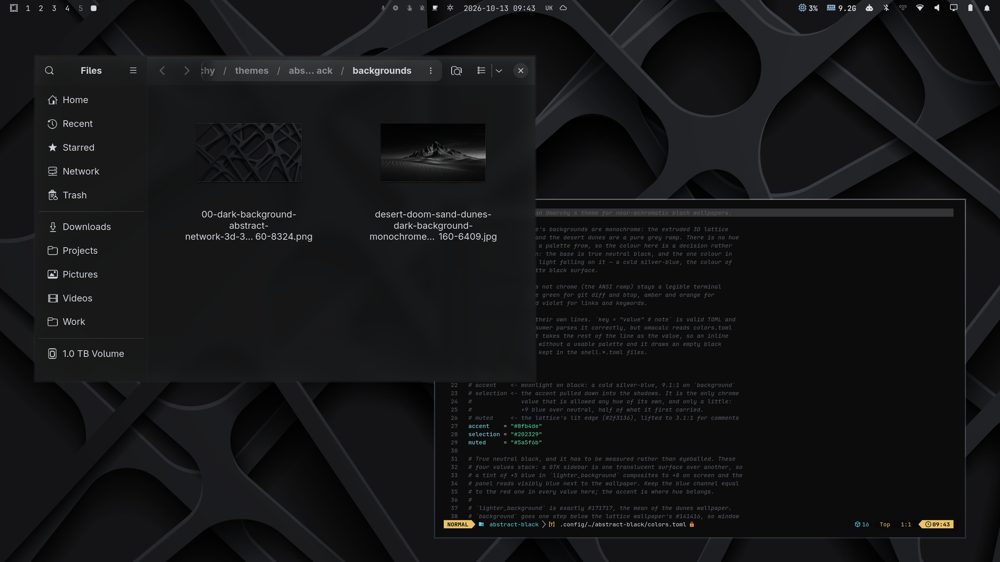
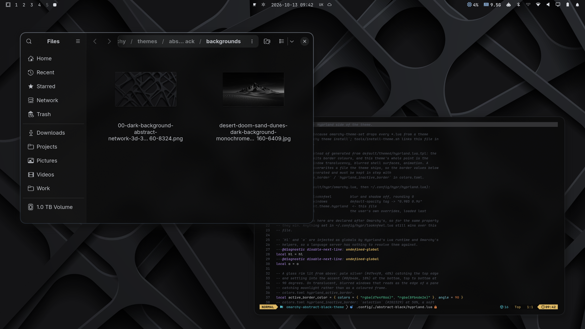

# Abstract Black

An [Omarchy 4](https://omarchy.org/) theme for black wallpapers: true neutral
black surfaces, frosted glass over a Hyprland blur, and one colour — the cold
silver-blue of moonlight falling on a matte black surface.

| From `omarchy theme install` | Abstract Black, full |
|:---:|:---:|
|  |  |

**Quick start** — the palette, the wallpapers and the shell colours, the way
the Omarchy theme gallery installs it:

```bash
omarchy theme install https://github.com/devSviat/omarchy-abstract-black-theme
```

**The full theme** — the same plus the glass: blur, translucent terminals and
animations (details in [Install](#install)):

```bash
git clone https://github.com/devSviat/omarchy-abstract-black-theme.git ~/Projects/omarchy-abstract-black-theme
cd ~/Projects/omarchy-abstract-black-theme
./tools/install-theme.sh
omarchy theme set abstract-black
```

[Two ways to install](#two-ways-to-install) lists exactly what each one gives
you.

## The idea

Both of this theme's wallpapers are monochrome. The extruded 3D lattice
averages `#141416`; the desert dunes are a pure grey ramp. Neither has a hue to
draw a palette from, so the colour here is a decision rather than an
extraction: everything structural stays true neutral black, and the single
colour in the chrome is the *light* — a cold silver-blue that runs down the
window rim, lights the selected row, and fills the Omarchy mark on the boot
splash.

That also decides three things the wallpapers set directly:

| | Why |
|---|---|
| `rounding 14`, `rounding_power 2.5` | the lattice is built from generously rounded extrusions, so the windows sit in the same family as the shapes behind them |
| shadow offset `3 6` | both wallpapers are lit from the upper left and cast down-right; the windows do the same instead of floating in a symmetric halo |
| blur `brightness 0.80`, `vibrancy 0.10` | there is nothing bright behind the windows to pull down, and vibrancy on an achromatic wallpaper can only invent a colour cast out of noise |

## Two ways to install

| | `omarchy theme install` | `tools/install-theme.sh` |
|---|---|---|
| Palette, wallpapers, bar, icons, unlock screen | yes | yes |
| Blur, rounded glass windows, shadows, animations | no | yes |
| Terminals | opaque, generated by Omarchy from the palette | translucent over the blur |
| Menu, launcher, notifications, popups | near-opaque cards (0.94) | frosted glass (0.62 – 0.78) |

A theme cloned by `omarchy theme install` is treated as untrusted: Omarchy
drops every `*.lua` and the four terminal configs from it and generates its
own from `colors.toml`. Those are exactly the files that carry the blur, the
animations and the terminal transparency, so they are kept here under a
`.example` suffix — `hyprland.lua.example`, `foot.ini.example` and so on —
which Omarchy stages but never loads.

`install-theme.sh` builds the theme as a directory of symlinks into your
checkout and links every `<name>.example` in as `<name>`. That directory holds
no `.git`, so Omarchy stages it in full. The four `shell.*.toml.example` files
are the translucent menu, launcher, notification and popup cards; without a
blur behind them the window underneath shows through the text, so the plain
`shell.*.toml` files the gallery install uses are near-opaque instead.

To move from the gallery install to the full one, remove it first —
`omarchy theme remove abstract-black` — then follow [Install](#install); the
script refuses to replace a theme directory it did not create.

## Install

The full theme. Needs Omarchy 4 (Hyprland with the Lua config and the Quickshell bar).

1. **Get the repo** somewhere permanent — the theme points into it, so don't
   move or delete it afterwards:

   ```bash
   git clone https://github.com/devSviat/omarchy-abstract-black-theme.git ~/Projects/omarchy-abstract-black-theme
   cd ~/Projects/omarchy-abstract-black-theme
   ```

2. **Install it:**

   ```bash
   ./tools/install-theme.sh
   ```

   This creates `~/.config/omarchy/themes/abstract-black` as a directory of
   absolute symlinks into the repo — all but `unlock.png`, which is copied
   because Omarchy refuses a symlinked unlock logo. It then shows up in Omarchy
   Menu → Style → Theme as **Abstract Black**.

3. **Apply it** — from that menu, or:

   ```bash
   omarchy theme set abstract-black
   ```

   Check it came up clean: `hyprctl configerrors` should print nothing.

4. **Optional extras:**

   - *GTK apps (Files, Disks, …)* read the theme's `gtk.css` only through a
     user-level link, and only at startup:

     ```bash
     ln -sfn ~/.local/state/omarchy/current/theme/gtk.css ~/.config/gtk-4.0/gtk.css
     nautilus -q    # then reopen Files
     ```

   - *Boot splash and login screen:* Omarchy Menu → Style → Unlock → Abstract
     Black, or `omarchy-plymouth-set-by-theme abstract-black` (asks for sudo,
     rebuilds the initramfs).

   - *The bar* works with its background on or off — double-click the bar to
     switch. The theme's bar tint shows only with the background on.

   - *Retake the thumbnails* after changing the palette: pick an empty
     workspace and run `PREVIEW_WORKSPACE=<n> ./tools/capture-preview.sh`. It
     applies each look for real — the gallery install included, staged the way
     Omarchy would stage a clone — screenshots it (with `grim`, `foot`,
     `nvim` and Files, all shipped with Omarchy; close Files first) and puts
     your previous theme back.

### Update

```bash
cd ~/Projects/omarchy-abstract-black-theme
git pull
./tools/install-theme.sh           # picks up new or renamed files and a changed unlock.png
omarchy theme set abstract-black   # re-apply to stage the changes
```

### Uninstall

Switch to another theme first, then:

```bash
rm -r ~/.config/omarchy/themes/abstract-black   # links and an unlock.png copy, the repo is untouched
```

If you set up the extras, also remove the `~/.config/gtk-4.0/gtk.css` link.
Then delete the repo itself.

## Palette

| Role | Value | From |
|---|---|---|
| `background` | `#0b0b0b` | true neutral black — blue channel equal to red, measured not eyeballed |
| `dark_background` / `darker_background` | `#080808` / `#050505` | one and two steps below |
| `lighter_background` | `#171717` | the mean of the dunes wallpaper exactly; also the bar's tint |
| `foreground` | `#d7dae0` | the silver highlight on the dune ridge, cooled |
| `accent` | `#8fb4de` | moonlight on black — 9.1:1 on `background` |
| `selection` | `#202329` | the accent pulled down into the shadows — the only chrome value with any hue |
| `muted` | `#5a5f6b` | the lattice's lit edge (`#2f3136`), lifted to 3.1:1 for comments |
| active border | pale silver `#d7e4f8` 40% → accent `#8fb4de` 18%, 90°; inactive `#202329` 50%; shell rims at 85% | a glass rim lit from above |
| `green` | `#57d9a3` | a console green, for `git diff` and btop |
| `yellow` / `orange` | `#ecc46a` / `#f0894a` | warnings and diagnostics |
| `blue` / `magenta` | `#5aa2f0` / `#a67cf0` | links and keywords |

## Glass

The full install. A file listed with `.example` is linked in without the
suffix.

| What | Where | Setting |
|---|---|---|
| Blur | `hyprland.lua.example` | size 9, 3 passes, brightness 0.80, vibrancy 0.10 |
| Glass edge | `hyprland.lua.example` | rim border, superellipse corners (`rounding_power 2.5`), shadow offset 3 px right / 6 px down |
| App windows | `hyprland.lua.example` | opacity 0.90 active / 0.82 inactive |
| Terminals | `foot.ini.example`, `ghostty.conf.example`, `alacritty.toml.example`, `kitty.conf.example` | background alpha 0.72 + blur requested, window 1.0 / 0.94 |
| Bar | `shell.bar.toml` | `lighter_background` at 0.62 → about `#141515`, one step *above* the windows' `#0d0d0e`, so it reads as chrome on the black rather than a hole in it |
| Menu / launcher | `shell.menu.toml.example`, `shell.launcher.toml.example` | card 0.68 / 0.62, scrim 0.1 (unblurred), selected row in the accent |
| Notifications / popups | `shell.notifications.toml.example`, `shell.popups.toml.example` | 0.72 / 0.78 |
| Polkit / tooltip / lock field | `shell.polkit.toml`, `shell.tooltip.toml`, `shell.lock.toml` | 0.85 / 0.9 / 0.55 |
| GTK apps (Files…) | `gtk.css` | rgba surfaces, with the sidebar and content panes pinned as real properties |

Terminals get alpha on the cell background rather than whole-window opacity, so
the text itself stays fully opaque. Each terminal config also asks for blur:
foot speaks `ext-background-effect-v1`, and without `blur=yes` it tells Hyprland
*not* to blur behind it — translucent but sharp, and no Hyprland setting can
override that. Browsers, video players, games and screen-share targets keep
Omarchy's opaque rules.

For more see-through, lower the alpha values above; for less, raise them.

One GTK quirk is worth knowing if you change the accent: libadwaita mixes
`--accent-bg-color` into its own surface backgrounds from inside its widget
rules, so setting `--sidebar-bg-color` neutral is not enough — under a blue
accent the Files sidebar still measured +8 blue against a wallpaper of +1. The
last block of `gtk.css` pins those surfaces as real `background-color`
properties, which the mix cannot reach. Keep each pin equal to the variable it
mirrors.

## Animations

In the full install: four curves, at the same speeds as
[omarchy-star-wars-theme](https://github.com/devSviat/omarchy-star-wars-theme):

| Curve | Shape | Used by |
|---|---|---|
| `lift` | fast with a slight overshoot | windows opening, special workspace |
| `settle` | eases in, then gone | windows closing, fades out, layers out |
| `glide` | long ease-out | moves, borders, fade in, focus switch |
| `shift` | slow start, hard jump, soft landing | workspace switches (`slidefade 20%`) |

The bar and menus keep Omarchy's own `no_anim` layer rules, so they still pop
instantly.

## Unlock

`unlock.png` is the official Omarchy mark — the one from
[omarchy.org/brand](https://omarchy.org/brand/), not the OMARCHY wordmark —
with its flat brand green swapped for this theme's own light: pale silver at
the top running down to the accent, the same gradient the window rim carries.

It is a **logo, not a wallpaper**. Omarchy's Plymouth script draws it centred at
its native size and puts the password entry 40 px below it, so a full-screen
image pushes the LUKS prompt off the display; it stays 520 px square with a
transparent background. Rebuild both it and its picker thumbnail with:

```bash
./tools/generate-unlock.sh      # ImageMagick + rsvg-convert, no network
```

Apply it separately, and only when you want it:

```bash
omarchy-plymouth-set-by-theme abstract-black   # sudo + mkinitcpio, takes a while
```

## Backgrounds

```
00-dark-background-abstract-network-3d-3840x2160-8324.png   <- default
desert-doom-sand-dunes-dark-background-monochrome-landscape-3840x2160-6409.jpg
```

Both are third-party wallpapers included as they are, with no recolouring. All
rights stay with their authors; the MIT license covers only the theme's own
files. Replace or add your own by dropping files into `backgrounds/` — anything
near-black and low in hue suits the palette.

## License

MIT for the theme's own files. See [LICENSE](LICENSE) for what it does not
cover — the wallpapers, and the Omarchy mark.
